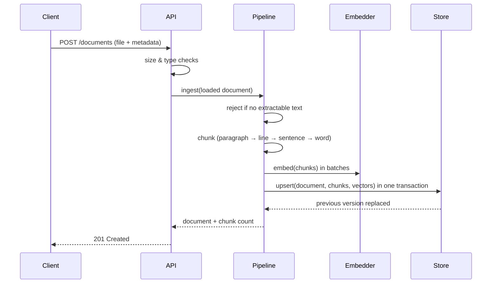
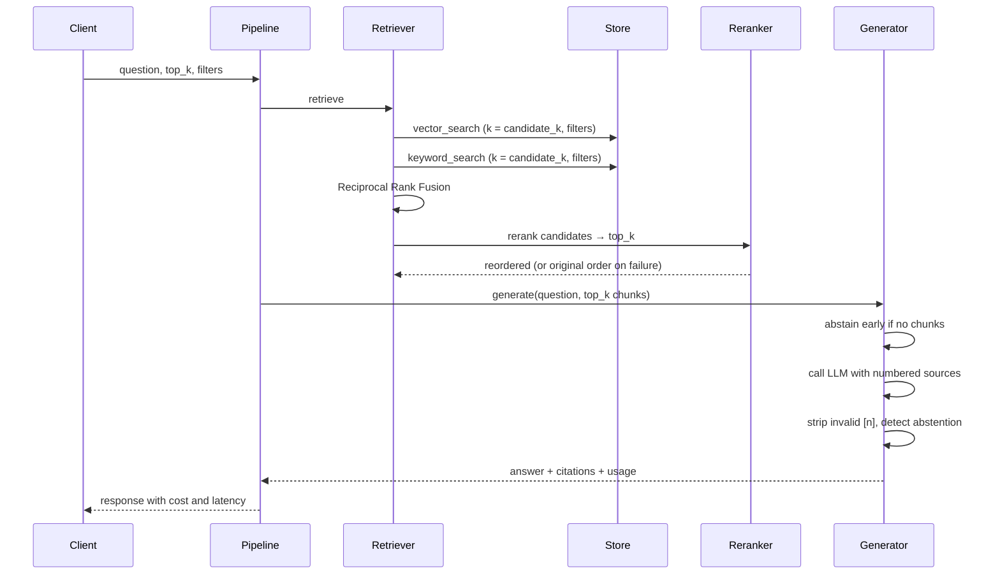

# Architecture

## Components

| Component | Module | Responsibility |
|---|---|---|
| Loaders | `ingestion/loaders.py` | Convert PDF, HTML, text and URLs into normalized page text |
| Chunker | `ingestion/chunking.py` | Split pages into overlapping chunks, keeping page numbers |
| Embedder | `embeddings.py` | Map text to vectors (OpenAI, or offline hashing) |
| Store | `store/` | Persist documents and chunks; vector search, keyword search, filters |
| Retriever | `retrieval/hybrid.py` | Gather candidates per mode and fuse them with RRF |
| Reranker | `retrieval/rerank.py` | Re-score candidates against the question |
| Generator | `generation/answer.py` | Produce a grounded answer, validate citations, abstain when needed |
| Pipeline | `pipeline.py` | Orchestrate ingestion and querying, log metrics |
| API | `api/main.py` | HTTP interface, validation, error mapping, request IDs |

Every component except the API depends only on interfaces (`Embedder`, `VectorStore`, `Reranker`, `LLM`). `factory.py` is the single place that chooses concrete implementations from settings.

## Ingestion flow



Document ids are derived from the source name, so re-uploading a file replaces it atomically (delete + insert inside one transaction).

## Query flow



## Database schema (pgvector backend)

```sql
documents (id TEXT PK, source TEXT, title TEXT, metadata JSONB, created_at TIMESTAMPTZ)

chunks (
  id TEXT PK,
  document_id TEXT REFERENCES documents ON DELETE CASCADE,
  chunk_index INT,
  text TEXT,
  metadata JSONB,
  embedding vector(N),
  tsv tsvector GENERATED ALWAYS AS (to_tsvector('english', text)) STORED
)

-- indexes: HNSW on embedding (cosine), GIN on tsv, GIN on metadata, btree on document_id
```

Keyword queries OR the stemmed terms of the question together and rank with `ts_rank_cd`. A plain AND query (the default for `plainto_tsquery`) returns nothing for most natural-language questions.

## Failure handling

| Failure | Behavior |
|---|---|
| LLM/embedding provider timeout or 5xx | SDK retries with exponential backoff (`RAG_LLM_MAX_RETRIES`), then error |
| Reranker call fails or returns invalid JSON | Logged; retrieval order is used |
| Model cites a source that wasn't provided | Reference removed from the answer; logged |
| Model says the sources don't contain the answer | `abstained: true` with a fixed message |
| Nothing retrieved | Abstain without calling the LLM |
| PDF without extractable text | `422` with a message pointing to OCR |
| Unsupported file type | `415` |
| URL fetch fails | `502` |

## Observability

Logs are JSON lines with a `request_id` (taken from `X-Request-ID` or generated) so one request can be traced across stages. Each stage logs its own metrics:

- `document ingested`: document id, chunk count, latency
- `retrieval complete`: mode, reranker, candidate count, latency
- `query answered`: abstained, citation count, tokens, cost, latency
